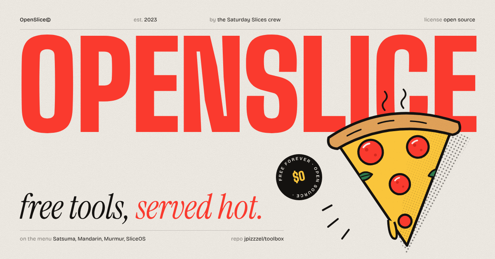

<p align="center">
  
</p>

# OpenSlice

Free tools, served hot.

Hi. We're Jonah Pflaster and Peter Morganelli. We've been roommates since freshman year (fall 2023), we're seniors now, and we still live together. We also run [Saturday Slices](https://saturdayslices.com/), a student run pizza place out of our house.

Somewhere along the way we picked up a habit. We find an app we'd happily pay for, rebuild it for ourselves, and then give it away. OpenSlice is where those rebuilds live. This repo is the website, and the site is the menu.

## What's on the menu

| Tool | What it is | Status |
| --- | --- | --- |
| Satsuma | Drag a file, hold Shift, drop it on a format. A file converter for Windows 10 and 11, our take on Tangerine. | Open beta: [tangerineforwindows-site.vercel.app](https://tangerineforwindows-site.vercel.app/) |
| Mandarin | The same drag and hold converter, rebuilt for the Mac. Peter's, and the one that started all this. | In the oven |
| Murmur | Hold a key, talk, let go. Dictation in the spirit of Wispr Flow. | In the oven |
| SliceOS | The system we built to run Saturday Slices: orders, prep, customers, money. | In the oven |

Mandarin, Murmur and SliceOS are working titles. The names might change before they ship. There are also a couple of classified slices on the list that we're not talking about yet.

## Running the site

You need Node and npm.

```sh
npm install
npm run dev       # local dev server
npm run build     # typecheck, then build to dist/
npm run preview   # serve the built site locally
```

## Stack

Vite and TypeScript, no framework. Animation is GSAP (with ScrollTrigger) and smooth scrolling is Lenis. Fonts are self hosted through Fontsource: Bricolage Grotesque, Big Shoulders Display, Instrument Serif and JetBrains Mono. Almost all the illustrations are SVG strings written right in the code, so there's barely an image folder.

## Where things live

```
src/
  core/        router, routes, page lifecycle, motion helpers
  pages/       one module per route (home, toolbox, tool, lab, about, slices, 404)
  chrome/      the stuff that sticks around: header, nav, cursor, preloader, transitions
  art/         SVG drawings: mascots, topping glyphs, posters
  data/site.ts all the copy and every tool, in one file
  styles/      tokens, base styles, one CSS file per page
public/        favicon, social image, manifest
```

If you only want to change words, `src/data/site.ts` is the file. Pages read from it, so nothing about a tool should be hardcoded anywhere else.

## Adding a tool

1. Open `src/data/site.ts`.
2. Add an object to the `TOOLS` array. Here's a made up one:

   ```ts
   {
     slug: "provolone",              // becomes /toolbox/provolone
     name: "Provolone",
     codename: true,                 // working title, drop it once the name is final
     kind: "Screenshots",
     platform: "macOS",
     status: "baking",               // "served" | "proofing" | "baking" | "prepping"
     by: ["jonah", "peter"],
     blurb: "One line for the lists.",
     story: "A paragraph for the detail page. Why we built it, what it replaces.",
     replaces: "Some paid app",     // optional
     features: ["One short line per feature"],
     links: [{ label: "Download", href: "https://example.com" }],
     color: "#2F7D4F",              // accent for its slice
     glyph: "mystery",              // a topping from src/art; "mystery" works until it gets its own
     year: 2026,
   },
   ```

3. Run `npm run dev` and open `/toolbox/provolone`. It shows up in the toolbox list and gets its own page automatically.
4. When it ships, flip `status` to `"proofing"` (open beta) or `"served"` (out of the oven) and add the real links.

The status labels the site shows ("Open beta", "In the oven" and so on) are in `STATUS_LABEL` in the same file.

## Deploying

We deploy on Vercel. Import the repo, keep the defaults (build command `npm run build`, output `dist`), and that's it. `vercel.json` already rewrites every route to `index.html`, so deep links like `/toolbox/satsuma` work on refresh.

## Contributing

Found a bug, or want to fix a typo? Read [CONTRIBUTING.md](CONTRIBUTING.md). It's short.

## License

MIT. See [LICENSE](LICENSE). Fork it and build your own toolbox if you want.

Made by Jonah ([jonahpflaster.me](https://www.jonahpflaster.me/)) and Peter ([petermorganelli.dev](https://www.petermorganelli.dev/)) out of our house.
